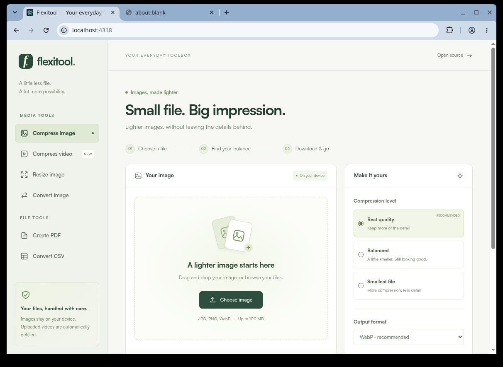

# Flexitool

An everyday toolbox for smaller images and videos, image resizing, format conversion, PDFs, and CSVs.



## Tools

- **Compress images:** JPG, PNG, and WebP; three quality presets; optional target size; proportional resizing; before/after previews and actual byte savings. Images stay in the browser.
- **Compress videos:** upload from the website, choose a quality preset or target size, optionally reduce resolution, then compare and download MP4. Native FFmpeg runs on the hosting server; no software installation is required for visitors.
- **Resize images:** original proportions by default, custom dimensions, or preset canvases with transparent padding instead of stretching.
- **Convert images:** JPG, PNG, WebP, and SVG wrappers containing raster images (not vector tracing).
- **Create PDFs** and **convert CSVs:** existing tools remain available.

## Quality and limits

“Best quality” prioritizes visual detail; it does **not** promise lossless compression or a fixed reduction. Already compressed files may not get smaller. Compare the result before downloading. A video target size overrides the quality preset and may noticeably reduce detail. Final sizes are approximate.

Image compression accepts still JPG/PNG/WebP files up to 100 MiB, 50 megapixels, and 16,384 pixels per side. Animated PNG/WebP files are rejected rather than silently flattened. Original dimensions are retained unless resizing is selected. PNG uses lossless encoding; resizing and converting from another format are separate operations. JPEG flattens transparency onto white. Re-encoding can remove metadata.

Video uploads default to 10 GiB per file. MP4/MOV, WebM/MKV and AVI are supported when FFmpeg can decode their codecs. Output uses H.264 video and AAC audio in MP4. It retains the first video track and the first available audio track; extra tracks, subtitles, chapters and metadata are omitted. Odd dimensions may be rounded down for codec compatibility. HDR sources are rejected to avoid unintended color changes. Videos longer than 24 hours or over 40 megapixels are rejected. The browser may be unable to preview a source codec that the server can still convert.

## Run locally

Requirements: Node.js 22+, npm, native `ffmpeg` and `ffprobe` available in PATH. On Debian/Ubuntu, install FFmpeg with `sudo apt-get install ffmpeg`; on macOS, `brew install ffmpeg`.

```sh
npm ci
npm run build
npm run serve
```

Open `http://localhost:4318`. This runs the complete website and video API together.

For development, run `npm run server` in one terminal and `npm start` in another. React uses port 3000 and proxies `/api` to the video server on port 4318. If FFmpeg is unavailable, image/file tools still work and video compression is visibly unavailable.

## Host the complete website

Use the included Dockerfile on a container host or VPS with sufficient temporary disk space. Static hosts and short-lived serverless functions cannot run these multi-GB video jobs. The same server serves the React build and `/api`; visitors use only their browser.

```sh
docker build -t flexitools .
docker run --rm -p 4318:4318 \
  -e PUBLIC_ORIGIN=https://tools.example.com \
  -e MAX_DISK_BYTES=34359738368 \
  flexitools
```

Replace the example origin with the actual HTTPS website origin. Terminate TLS at a reverse proxy. Allow request bodies up to your configured upload limit, disable request buffering for the upload route, and set request/read timeouts long enough for uploads and downloads. Check the hosting provider's hard request-size and timeout limits: code supporting 10 GiB does not make a restrictive provider support it. Put request/rate controls and any desired account or payment limits at the edge before operating an unrestricted public service.

The worker encodes one video at a time. Jobs and access tokens live in memory; restarting a container loses job status and cancels processing. Run one replica, or use sticky routing so upload, polling, preview and download reach the same replica. Each replica needs its own temporary directory/volume. This is a bounded single-instance implementation, not a durable distributed queue.

### Environment

| Variable | Default | Purpose |
| --- | --- | --- |
| `HOST` | `127.0.0.1` (`0.0.0.0` in Docker) | Listen address |
| `PORT` | `4318` | Website and API port |
| `PUBLIC_ORIGIN` | Derived from request host | Exact allowed website origin; set behind TLS/proxies |
| `MAX_UPLOAD_BYTES` | `10737418240` | 10 GiB input limit |
| `MAX_DISK_BYTES` | `34359738368` | Total temporary storage reservation budget |
| `MAX_PENDING_JOBS` | `4` | Concurrent uploads plus queued/processing jobs |
| `MAX_JOBS` | `24` | Retained job records, including completed downloads |
| `RETENTION_MS` | `3600000` | Retention after processing ends |
| `UPLOAD_TIMEOUT_MS` | `1800000` | Maximum upload time, 30 minutes |
| `VIDEO_TEMP_DIR` | OS temp + `flexitools-video` | Dedicated private directory per replica |
| `FFMPEG_PATH`, `FFPROBE_PATH` | PATH executables | Override native binary locations |

The admission budget reserves input plus up to twice the input size for output (at least 64 MiB), plus 128 MiB for auxiliary files. Provide disk headroom beyond the configured reservation budget. Completed jobs release input/log reservations and retain only output bytes. Very large targets can exceed the job's output budget and will fail explicitly rather than returning a truncated video.

## Privacy and cleanup

Image, resize, conversion, PDF and CSV work remains local to the browser. Video upload requires an explicit checkbox. Videos are streamed to private temporary files; random per-job tokens authorize status, preview, download and deletion. There is no public job listing.

Input video and encoding logs are removed after successful conversion. Output is removed about 60 minutes after processing finishes (cleanup runs every minute), or sooner via **Delete server files**. Cancellation closes the upload/encoder/download and removes temporary files. Active downloads delay expiry until they finish. Abandoned files from a previous process are checked on startup and cleaned after their retention period. Deletion depends on the hosting filesystem, and operators must account for any infrastructure backups. Do not log capability-token query strings at the proxy.

## Verification

```sh
CI=true npm test -- --watchAll=false --runInBand
npm run test:server
npm run build
```

The browser/UI suite covers image headers and limits, target-size behavior, actual export types, stale result cleanup, cancellation races, upload consent, service failures, and retries. Server tests generate real FFmpeg fixtures and exercise encoding/audio, targets, resizing, downloads, Range previews, tokens, cleanup, concurrent admission and storage accounting.

`npm run test:large-video` is an optional streaming smoke test that creates a sparse MP4 larger than 2 GiB, uploads it, encodes it and removes its temporary files. It needs at least 3 GiB of free disk and native FFmpeg. The padding verifies transport and memory behavior, not compression quality. It is not part of the default test suite.

See [design review and verification notes](docs/design-review.md) for current screenshots, test evidence and remaining manual checks.

Built by Sch1xo · Acestar Villam Domum.
