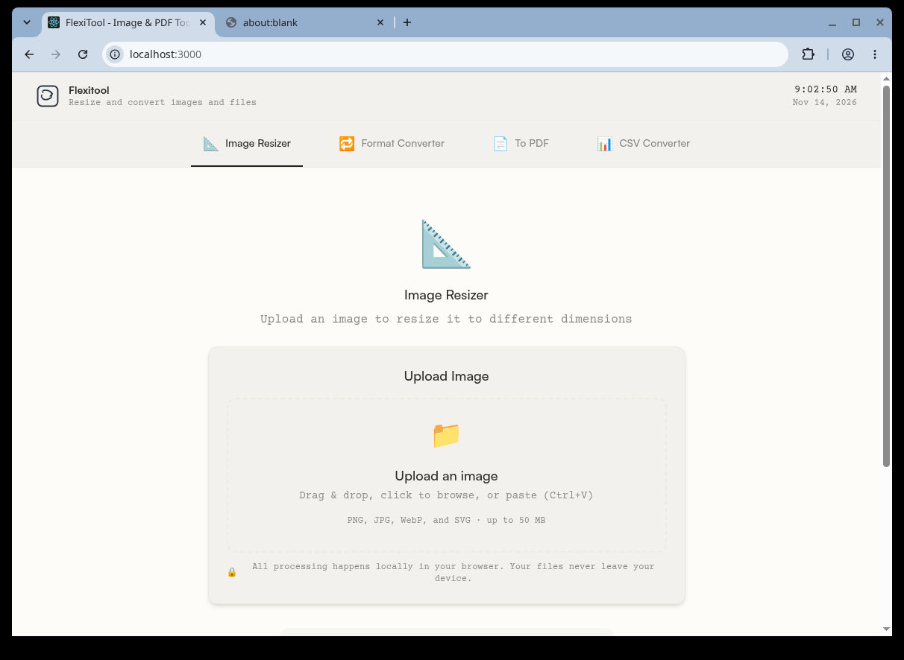
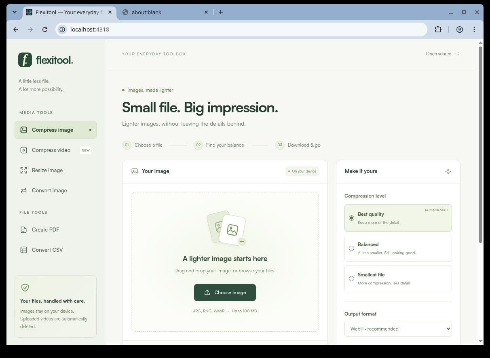
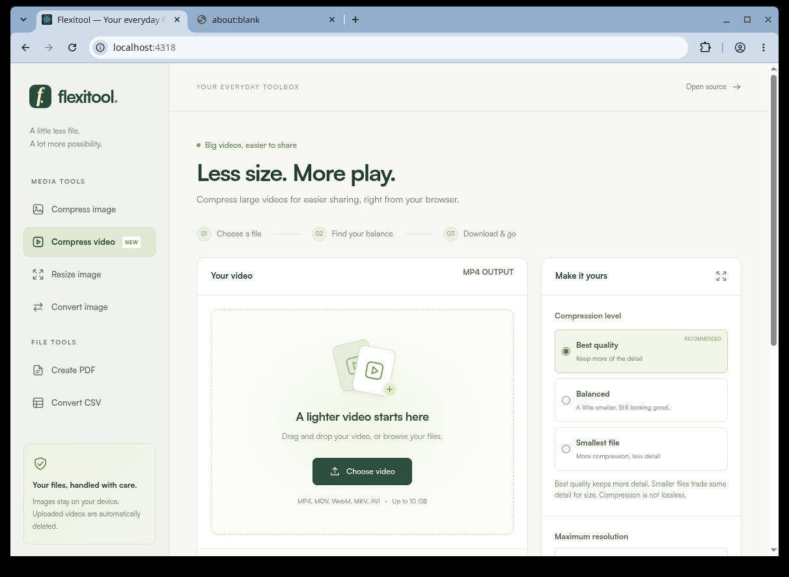
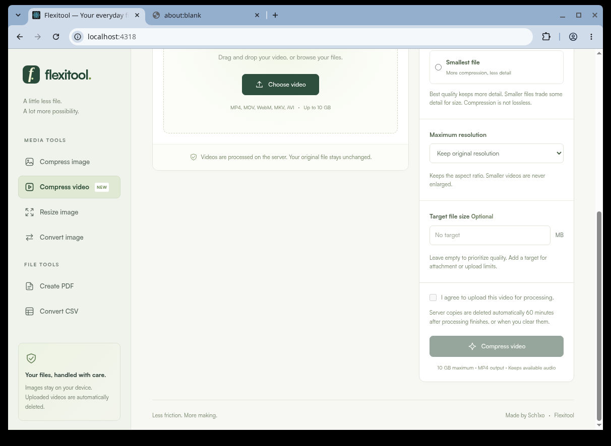

# Flexitool design and flow review

## What changed

The existing cream palette is now a warm, green workspace with persistent tool navigation, a clear heading, an upload panel beside settings, visible privacy information, quality choices and a separate result/download state. The original tools remain accessible. Compression stays active when switching between the image and video tools.

## Captured steps and health

1. **Starting image upload — needed improvement.** The previous screen repeats the image-resizer/upload heading three times, places the upload action well below the navigation, and uses very light explanatory text. This screenshot was captured at the start of the implementation, after initial upload-validation repairs but before the layout redesign.

   

2. **Image compression workspace — improved desktop hierarchy.** Upload, available formats, file limit, privacy and quality presets appear in one workspace. Output format and dimensions are separate settings. The result shows actual byte sizes and a visual comparison; larger results do not claim savings. Tests cover settings clearing outdated downloads.

   

3. **Video compression workspace — clear task and processing location.** The video tool uses the same layout and displays its server-configured file limit. It accepts a file before processing; the file is not uploaded merely by selecting it.

   

4. **Video settings and consent — explicit tradeoffs.** Resolution and target bytes are separate choices. Upload requires consent, explains server retention, and keeps the action disabled until required input exists. This lower part of the settings panel requires scrolling on this desktop viewport.

   

## Behavior and accessibility

- Named navigation and form controls, native quality radio groups, keyboard-operable file selection, visible focus, a skip link, live status/error messages and progress semantics.
- Mobile CSS changes the sidebar to horizontal labelled tool buttons and stacks the workspace. Mobile inputs use a 16px font and primary controls have 44px minimum heights.
- Reduced-motion preferences disable decorative animations. Images and videos have explicit preview labels.
- Legacy resizing defaults to original proportions, and preset canvases use padding instead of stretching. File extensions now match the actual PNG/JPG/WebP output.
- Image compression keeps local files private. The video consent explicitly describes upload/server processing; there is no blanket “everything stays local” claim.

These checks do not establish full accessibility compliance. Screen-reader behavior, narrow-screen touch interaction and real-device visual quality need manual review.

## Verification evidence

- Production build: passed with CI mode enabled.
- Frontend: **43 passing tests** across image engine, legacy export behavior, real dropzone selection/rejections, and image/video state and cancellation flows.
- Backend: **23 passing native FFmpeg integration tests**, including two-pass targets, audio, resize, seekable previews, streamed download, job tokens, admission concurrency, storage reconciliation, Unicode names and cleanup.
- Large transfer: a valid MP4 with a synthetic `free` box, **2,150,050,804 bytes**, uploaded, encoded and downloaded successfully in the local environment. The Node client and server together peaked at approximately **131 MiB RSS** in the bounded-stream test. FFmpeg runs separately; its memory is not included. This verifies transport beyond 2 GiB, not the compression ratio of real footage.
- Separate synthetic 3-second 1280 × 720, 24 fps test clip with audio: **2,566,132 → 1,534,580 bytes**, about **40% smaller** at the best-quality video preset. FFmpeg SSIM: **0.998574**. This is one artificial fixture, not a promise of savings or visual similarity on other files.

## Remaining manual checks before deployment

Desktop image/video/settings screens were inspected and captured. This session's browser-control runtime could not initialize its DOM/file-chooser automation, and native chooser attempts did not deliver a selected file back to the page. The managed browser also blocked DevTools, so mobile emulation was unavailable. Upload selection is covered by real dropzone tests and video transport by native integration tests, but a complete browser upload → compress → preview → download run and mobile screenshots remain manual checks.

The Dockerfile is supplied, but a Docker image build and a real hosting-provider deployment have not been run here. The site is not deployed by this change. Confirm the selected provider permits multi-GB streamed bodies, long requests and enough temporary storage. Static-only hosting will continue to run local image/file tools but cannot provide the video API.
