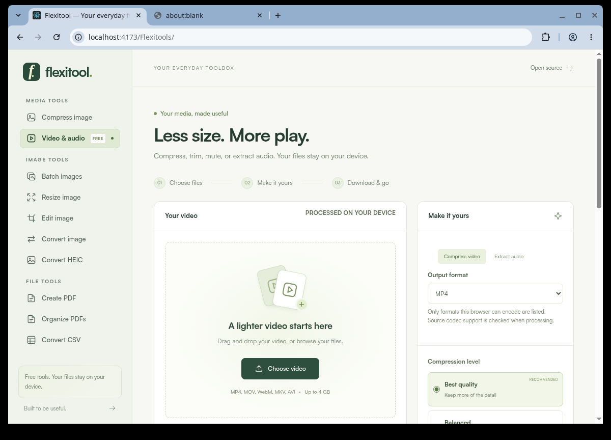
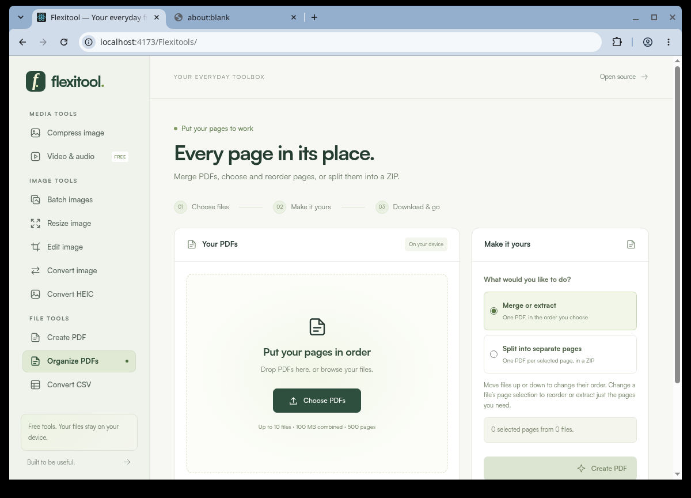
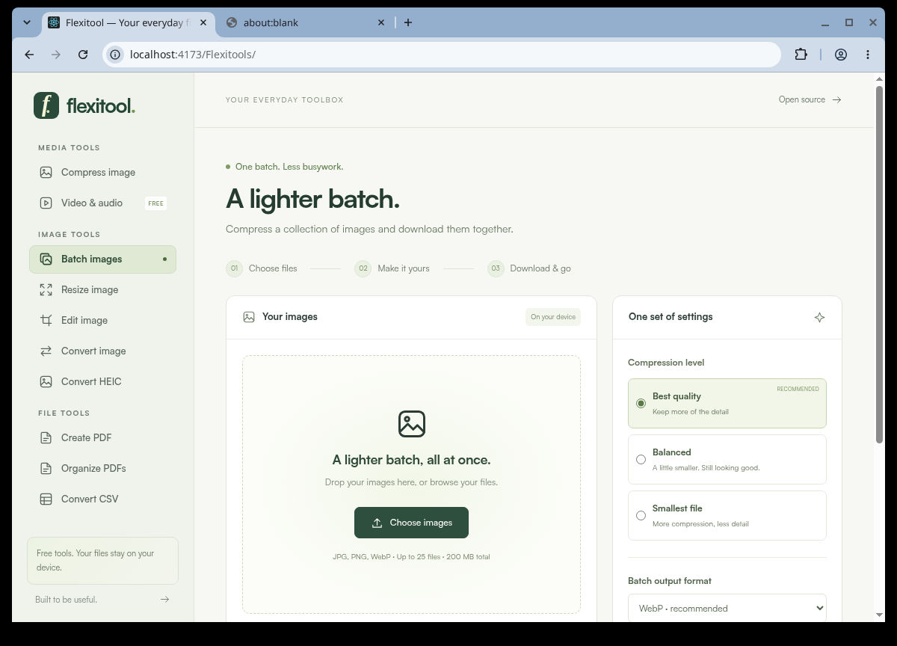

# Free toolbox verification — 2026-11-14

The default app now runs entirely in the browser. The earlier server implementation is optional and is not imported by App. This document supersedes the initial server-oriented hosting conclusions in `design-review.md`.

## Completed checks

- `CI=true npm test -- --watchAll=false --runInBand`: **16 suites, 145 tests passed**.
- `CI=true PUBLIC_URL=/Flexitools GENERATE_SOURCEMAP=false npm run build`: **passed**, including TypeScript and CRA ESLint checks. The build uses the project subpath required by GitHub Pages.
- `git diff --check`: passed.
- Real PDF tests verify merged page contents/order, extracted/repeated ranges, ZIP entries, malformed/encrypted inputs, and limits. Real ZIP tests verify names and byte contents.
- Two media integration tests use actual Mediabunny 1.66.0 without a mocked conversion engine: a generated one-second PCM WAV is trimmed to half a second, demuxed again, and checked for duration/sample data. Direct disk output, including header rewrites, is byte-identical to the Blob output.
- Media unit/UI tests cover codec failures, HDR rejection, trim/resize/mute/extraction settings, bounded output, cancellation, stale metadata/results, direct-save errors and cleanup. HEIC tests mock decoding and verify container validation, MIME checks, cancellation and URL cleanup. An official libheif still-image fixture was also accepted by the actual HEIC metadata parser.
- Independent implementation review checked the browser engine against the installed Mediabunny API and reviewed cross-tool lifecycle/limits. Its documentation finding was fixed by replacing the server-first README and moving server instructions into their own optional document.
- Served the production build using Python's static HTTP server at `/Flexitools/`, without the video API. Desktop browser navigation successfully loaded image compression, video/audio, batch images, image editing, HEIC conversion, and PDF organization. The browser's runtime probe offered MP4 encoding on the video screen.
- Static assets total approximately 6.4 MB; the largest deployed file is 3,224,560 bytes (the lazy HEIC decoder), below Cloudflare Pages Free's 25 MiB per-asset limit. Source maps were excluded from this published-build check.

## Visual evidence

The expanded desktop sidebar displays all ten tools at the observed viewport. The existing responsive layout collapses navigation into a horizontal tool list on small screens.

## Remaining manual checks

The managed browser automation could not attach selected files: its native chooser closed but the app's input remained empty. Consequently, **real WebCodecs video encoding and HEIC pixel decoding were not verified end to end in this browser**. The desktop layouts and capability probe were observed; mocked tests alone are not evidence of codec output quality. Complete a supported-browser smoke test with representative H.264/AAC, WebM, portrait/rotated, silent and HEIC files, then play/reopen the downloads. Also check direct-save cancellation, a real multi-GB file, and mobile browsers on representative devices.

The browser's development preview retained a stale TypeScript diagnostic after adding HEIC module types. A clean production build passed, and its static preview loaded successfully. Test output includes the existing React Testing Library `act` deprecation; no tests failed. The older CRA toolchain also reports an outdated Browserslist database and a Node deprecation.

No multi-GB reliability claim, zero-quality-loss claim, production deployment, or Docker validation is made for this update. The native server's earlier FFmpeg tests/transport results describe that optional server only; they do not establish browser performance.
